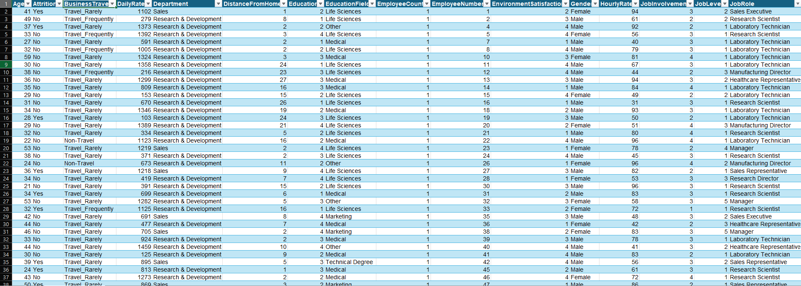
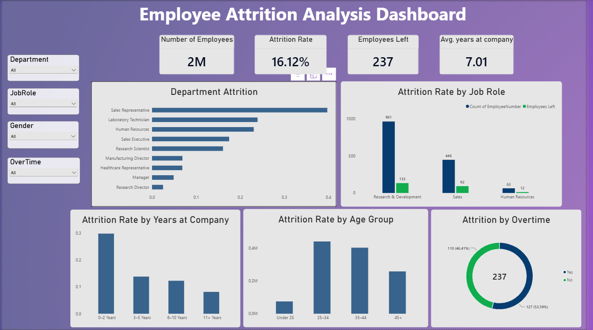

# HR Employee Attrition Insights | Excel & Power BI

An HR analytics project exploring employee attrition patterns, workforce demographics, and department-level trends using Microsoft Excel and Power BI.

---

## 📌 Project Overview

Employee attrition is an important workforce metric that helps organizations understand employee turnover and identify areas that may require further investigation.

This project analyzes the IBM HR Analytics Employee Attrition & Performance dataset to examine attrition patterns across departments and employee demographics. Excel is used for data preparation and analysis, while Power BI is used to build an interactive dashboard for presenting key metrics and trends.

The goal is to transform employee data into clear, accessible insights that can support further HR analysis and data-informed decision-making.

## 🎯 Project Objectives

- Calculate and present the overall employee attrition rate.
- Examine attrition across different departments.
- Analyze the average age of employees who left the organization.
- Explore attrition patterns across employee age groups.
- Develop an interactive Power BI dashboard to communicate key findings.
- Practice an end-to-end analytics workflow, from data preparation to visualization.

## 🗂️ Dataset

**Dataset:** IBM HR Analytics Employee Attrition & Performance

- **Total employee records:** 1,470
- **Total attributes:** 35
- **Data type:** Employee and workforce-related information

The dataset contains employee attributes that can be used to explore workforce demographics, job-related characteristics, and attrition status.

## 🛠️ Tools & Technologies

| Tool | Purpose |
|---|---|
| Microsoft Excel | Data review, cleaning, preparation, and analysis |
| Power BI | Dashboard development and data visualization |
| Power Query | Data preparation and transformation, where applicable |
| DAX | Measures and KPI calculations, where applicable |

## 🔄 Project Workflow

### 1. Data Understanding
Reviewed the dataset structure, columns, and employee attributes to understand the information available for analysis.

### 2. Data Preparation
Prepared the dataset for analysis by reviewing data quality and ensuring the fields required for the analysis were suitable for use.

### 3. Exploratory Data Analysis
Examined employee attrition in relation to department and age-related characteristics to identify patterns and differences within the workforce.

### 4. KPI Analysis
Focused on the following metrics:

- Overall attrition rate
- Department-wise attrition
- Average age of employees who left the organization
- Attrition patterns across age groups

### 5. Dashboard Development
Created a Power BI dashboard to present important metrics and visual comparisons in a structured format, making the analysis easier to explore and interpret.

## 📊 Dashboard Preview

### Employee Data Preview

### Power BI Dashboard

## 📈 Key Areas of Analysis

### Overall Employee Attrition
Examines the proportion of employees who left the organization relative to the total employee population.

### Department-Level Attrition
Compares attrition across departments to identify differences in employee turnover patterns.

### Age-Related Analysis
Examines the average age of employees who left and explores how attrition varies across employee age groups.

### Workforce Insights
Brings together key workforce metrics in a dashboard to make comparisons easier and highlight areas that may warrant additional investigation.

*Note: These are the primary areas investigated in the project. Specific numerical findings should be interpreted from the completed dashboard and analysis.*

## 📁 Project Files

- 📊 [**Power BI Dashboard (.pbix)**](./Files/HR%20attriation.pbix)
- 📗 [**Excel Analysis (.xlsx)**](./Files/Employee_attriation.xlsx)

**Note:** Download the Power BI file and open it using Power BI Desktop to explore the dashboard interactively. The Excel workbook can be downloaded and opened in Microsoft Excel or a compatible spreadsheet application.

## 💡 Business Relevance

This project demonstrates how HR data can be organized and visualized to help stakeholders:

- Monitor employee attrition metrics.
- Compare turnover patterns across departments.
- Explore differences between employee demographic groups.
- Identify areas for further investigation and workforce analysis.
- Communicate findings through a visual reporting dashboard.

The analysis can support exploratory HR reporting, but additional information would be needed to determine why employees leave or what interventions would be effective.

## ⚠️ Limitations

- The analysis is based on the available dataset and its recorded attributes.
- Observed differences do not establish causation.
- The results should not be generalized to every organization without additional evidence.
- Further analysis would be required to evaluate possible drivers of attrition and assess the effectiveness of retention strategies.

## 🚀 Skills Demonstrated

- Data cleaning and preparation
- Exploratory data analysis (EDA)
- KPI analysis and reporting
- Employee attrition analysis
- Excel-based data analysis
- Power BI dashboard development
- Data visualization and insight communication
- Business and HR analytics

## 👨‍💻 Author

**Tanmay Khandait**

Data Analytics | Business Intelligence

[LinkedIn](https://www.linkedin.com/in/tanmay-khandait-45914b224) · [GitHub](https://github.com/Tanmayk30)

---

*This project was developed for data analytics practice and portfolio demonstration.*
